```
┏━╸╺┳┓╻┏    ┏┓ ┏━╸┏━┓╻ ╻
┃   ┃┃┣┻┓╺━╸┣┻┓┣╸ ┗━┓┃ ┃
┗━╸╺┻┛╹ ╹   ┗━┛┗━╸┗━┛┗━┛
```

**Deploy a Hyperledger Besu QBFT chain, connected to Agglayer.**

This repository is a step-by-step guide for standing up a [Hyperledger Besu](https://github.com/hyperledger/besu) chain that runs QBFT (Besu's Byzantine fault tolerant proof-of-authority consensus) and attaching it to the [Agglayer](https://agglayer.github.io/). It serves chain operators bringing up a new chain as a devnet, testnet, or production network on **Sepolia** or **Ethereum mainnet**. The guide covers one deployment path: Pessimistic Proof (PP) with the `AggchainECDSAMultisig` consensus contract, plus an optional configuration for a chain run jointly by a consortium.

> [!NOTE]
> This guide creates a new chain, with the Agglayer bridge and GER (Global Exit Root) contracts in its genesis. Connecting a chain that already exists, with its own history, follows the Agglayer Outpost path, which this guide does not cover.

> [!IMPORTANT]
> The commands in this guide pass private keys directly on the command line for clarity. For testnet and mainnet deployments, use a keystore or hardware wallet. Never use literal private keys, and never commit them to version control. See [Prerequisites](00-prerequisites.md) for guidance.

## Security model

The Pessimistic Proof protects the shared bridge. It proves that the chain cannot withdraw more than it deposited, which caps the damage a faulty or compromised chain can do to the rest of the Agglayer network.

It does not prove the chain's internal state transitions, and the chain posts no transaction data to L1. The chain's state lives on the operator's validators. For a private ledger this is the intended design, and you should understand it before you deploy.

Think of the Agglayer as the auditor of a vault's withdrawal log: it cannot see inside the building, but it limits what leaves the vault to what came in.

## Architecture

Contract docs: https://agglayer.github.io/protocol-team-docs/smart-contracts/v12/AggchainECDSAMultisig/

The PP proves that every withdrawal claim the chain makes against the unified bridge is backed by a real deposit, and SP1 (Succinct's zero-knowledge virtual machine) generates that proof on the Succinct Prover Network.

```mermaid
%%{init: {'flowchart': {'defaultRenderer': 'elk'}} }%%
flowchart LR
    %% External actors
    User((User))
    L1[L1]
    SPN[Succinct Prover<br/>Network]

    %% Trusted Environment boundary
    subgraph TE["Trusted Environment"]
        direction TB

        subgraph BESU[" "]
            direction LR
            besurpc[besu RPC node]
            besuval[besu validators<br/>QBFT]
        end

        subgraph AGGSTACK[" "]
            direction LR
            bridgeservice[bridge-service]
            aggkit[aggkit]
            aggval[aggsender-validators<br/>optional]
        end

        agglayernode[agglayer-node]
    end

    %% ===== Main flow (solid, numbered) =====
    User -->|"1. Submit txn"| besurpc
    besurpc -->|"2. Propose and finalize block"| besuval
    aggkit -->|"3. Set GER"| besurpc
    aggkit -->|"4. Collect certificate signatures (optional)"| aggval
    aggkit -->|"5. Submit certificate for settlement"| agglayernode
    agglayernode -->|"6. Request Pessimistic proof"| SPN
    agglayernode -->|"7. Submit settlement txn"| L1

    %% ===== Periodical operations (dashed orange) =====
    bridgeservice -.->|"Read bridge events"| L1
    bridgeservice -.->|"Read bridge events"| besurpc
    aggkit -.->|"Read GER/bridge events"| L1
    aggkit -.->|"Read bridge events"| besurpc

    %% ===== Styling =====
    classDef besuComp stroke:#e03131,stroke-width:2px,fill:#fff,color:#1e1e1e
    classDef aggComp stroke:#7950f2,stroke-width:2px,fill:#fff,color:#1e1e1e
    classDef l1Box stroke:#1e1e1e,stroke-width:2px,fill:#a5d8ff,color:#1e1e1e
    classDef userCircle stroke:#1e1e1e,stroke-width:2px,fill:#ffd8a8,color:#1e1e1e
    classDef spnBox stroke:#f783ac,stroke-width:2px,fill:#fcc2d7,color:#1e1e1e

    class besurpc,besuval besuComp
    class aggkit,aggval,bridgeservice,agglayernode aggComp
    class L1 l1Box
    class User userCircle
    class SPN spnBox

    style TE stroke:#1e1e1e,stroke-width:2px,stroke-dasharray: 8 8,fill:transparent,color:#1e1e1e
    style BESU stroke:#e03131,stroke-width:2px,stroke-dasharray: 8 8,fill:transparent
    style AGGSTACK stroke:#7950f2,stroke-width:2px,stroke-dasharray: 8 8,fill:transparent

    %% Periodical links rendered in orange dashed (indices 7-10)
    linkStyle 7 stroke:#f08c00,stroke-width:2px,stroke-dasharray: 4 6
    linkStyle 8 stroke:#f08c00,stroke-width:2px,stroke-dasharray: 4 6
    linkStyle 9 stroke:#f08c00,stroke-width:2px,stroke-dasharray: 4 6
    linkStyle 10 stroke:#f08c00,stroke-width:2px,stroke-dasharray: 4 6
```



> [!NOTE]
> The dashed arrows are periodic reads: `bridge-service` and `aggkit` continuously read bridge and GER events from L1 and the Besu RPC node. Step 4 applies only to the consortium configuration in [chapter 07](07-consortium-configuration.md).

## How cdk-besu differs from cdk-op-reth

| Area | cdk-op-reth | cdk-besu |
|---|---|---|
| Execution and consensus | `op-reth` plus `op-node` | One Besu node per validator, QBFT consensus |
| L1 data posting | `op-batcher` | None |
| Consensus contracts | `AggchainECDSAMultisig` (PP), `AggchainFEP` (FEP) | `AggchainECDSAMultisig` (PP) only |
| L2 contract deployment tool | `op-deployer` | None; Besu genesis built from the sovereign predeploys |
| Block finality tags | `safe` and `finalized` advance through `op-node` | Not served; aggkit tracks `latest` |
| Minimum aggkit | Per its own version table | 0.9 |
| Optional consortium setup | Not covered | Chapter 07 |

## Deployment Steps

Before starting, review the **[Prerequisites](00-prerequisites.md)** for host tooling, component versions, and the wallet accounts you'll need to fund.

> [!CAUTION]
> Callouts marked **Unverified** flag details that still need confirmation from testing or the Agglayer team. Check each one before a testnet or mainnet deployment.

1. **[Rollup Creation](01-rollup-creation.md)** - Initiate the Agglayer chain integration process with Polygon Labs to receive the deployment artifacts
2. **[Genesis Generation](02-genesis.md)** - Generate the Polygon genesis fragment with the sovereign bridge and GER predeploys
3. **[Besu Network Deployment](03-besu-network.md)** - Build the QBFT genesis and start the validators and the RPC node
4. **[Rollup Initialization](04-rollup-initialization.md)** - Initialize the rollup on-chain with the `AggchainECDSAMultisig` parameters
5. **[Polygon Stack Deployment](05-polygon-stack.md)** - Configure and run aggkit and the zkEVM Bridge Service against Besu
6. **[Verification and Operations](06-verification-and-operations.md)** - Confirm the chain settles on the Agglayer, then operate it
7. **[Consortium Configuration](07-consortium-configuration.md)** *(consortium only)* - Share block production and certificate approval across several organizations
