# cdk-besu: build spec for Claude Code

This spec tells you how to create the `0xPolygon/cdk-besu` repository: a step-by-step runbook for standing up a Hyperledger Besu QBFT chain and attaching it to the Agglayer on Sepolia or Ethereum mainnet. Model the repo on `0xPolygon/cdk-op-reth` and draw the Besu-specific details from the Kurtosis integration in `0xPolygon/kurtosis-cdk` PRs #949 and #950.

Read the whole spec before writing any file. Where the spec and a source file disagree, the spec wins. Where the spec says a detail is unverified, do not resolve it by guessing: leave the marker described in [Unverified details](#9-unverified-details-leave-markers-do-not-guess).

---

## 1. Goal and scope

The deliverable is a documentation repository: Markdown chapters, one helper script, a README with a Mermaid architecture diagram, and a `.gitignore`. It contains no application code and no CI.

The runbook serves chain operators, including banks and bank consortiums that already run Besu, who want Agglayer connectivity for a permissioned or private Besu chain. It covers one deployment path, **Pessimistic Proof (PP) with the `AggchainECDSAMultisig` consensus contract**, plus an optional consortium configuration.

The Pessimistic Proof guards the shared bridge only. It proves that a chain's withdrawal claims are backed by real deposits, so a faulty or malicious chain cannot drain other chains. It does not attest to the chain's internal state, and a Besu chain posts no transaction data to L1. The README states both facts plainly because they define the security model an operator is accepting.

Out of scope for this repo:
- FEP (Full Execution Proof, the `AggchainFEP` contract). Besu produces no validity proof, so FEP does not apply.
- The legacy `PolygonPessimisticConsensus` contract (`consensus_contract_type: pessimistic` in Kurtosis). See the aggkit version constraint in section 4.
- Changes to docs.polygon.technology. Those ship in a separate PR against the docs repo.
- Kurtosis changes. The multi-validator preset and the Besu image bump land in `kurtosis-cdk` separately.

## 2. Source material to read first

Clone or fetch these before writing. Cite file paths from them in your own reasoning, not in the runbook prose.

**Template repo: `0xPolygon/cdk-op-reth` (default branch)**
- `README.md`: structure, tone, the PP Mermaid diagram you adapt
- `00-prerequisites.md`: tables for L1s, host tooling, component versions, secrets handling, wallet accounts
- `01-rollup-creation.md`: reused almost verbatim
- `02-genesis.md`: the `createSovereignGenesis` flow you reuse
- `03-op-stack.md`: replaced entirely; read it only to match heading and callout conventions
- `04-rollup-initialization.md`: keep the PP path, drop the FEP-only steps 1 to 3
- `05-op-succinct-config.md`, `07-polygon-stack-fep.md`: FEP-only, not carried over
- `06-polygon-stack-common.md`: aggkit and zkEVM bridge service chapter you adapt
- `images/`: inspect it and carry over only images that are not OP Stack-specific

**Besu integration: `0xPolygon/kurtosis-cdk` (default branch, which includes merged PRs #949 and #950)**
- `src/chain/besu/besu.star`: Besu node flags, ports, and data layout
- `static_files/chain/besu/genesis-base.json`: QBFT genesis config block
- `static_files/chain/besu/build-genesis.sh`: `extraData` construction, alloc normalization and merge, node key format
- `static_files/contracts/create_op_allocs.py`: normalizer for the `createSovereignGenesis` output shapes
- `static_files/contracts/sovereign-rollup/create-genesis-sovereign-params.json`: the non-committee AggOracle parameters
- `static_files/chain/shared/aggkit/config.toml`: every Besu branch (`eq .sequencer_type "besu"`), the `[AggSender.ValidatorClient]` block, and the `[Validator]` section
- `src/chain/shared/aggkit.star`: how aggsender validators run (`--components=aggsender-validator`) and which keystore each one uses
- `src/package_io/input_parser.star`: `VALID_BESU_CONSENSUS_TYPES`, `DEFAULT_BESU_ARGS`, and the Besu sanity checks
- `docs/docs/configuration/examples/cdk-besu.md`: the Kurtosis-side explanation of the constraints
- `docs/docs/version-matrix.md`: the tested versions for `cdk-besu-sovereign-ecdsa-multisig`
- PR #949 conversation: the review confirms that `initialize_rollup` needs a live L2, so Besu must run before chapter 04

**Besu CLI (for verifying flags)**
Run `docker run --rm hyperledger/besu:<besu_version> --help`, plus `--help` on `operator generate-blockchain-config`, `rlp encode`, and `public-key export-address`. Every Besu flag the runbook uses must appear in that help output for the pinned version.

## 3. Writing rules for the runbook prose

The runbook is public-facing. Follow these rules in every file.

**Match the template's conventions:**
- Second person, imperative mood, one short intro paragraph per chapter that says what the chapter does
- GitHub alert syntax: `> [!WARNING]`, `> [!IMPORTANT]`, `> [!NOTE]`, `> [!TIP]`
- Environment variables in a `shell` block with the comment `# See Component Versions table in 00-prerequisites.md for current values` wherever a version variable appears
- A `**Source of Truth**:` pointer to upstream docs where the template uses one
- A horizontal rule and a `**Next:** [Title →](file.md)` footer on every chapter

**House style:**
- Write "Agglayer", never "AggLayer"
- Put code terms, file names, flags, config keys, and component names in backticks
- Use hyphens or restructure the sentence; never use em dashes. The template uses em dashes in places; do not copy them
- Keep sentences active and direct. Lead each section with the point
- Cut filler words: robust, seamless, crisp, clean, simply, just, easily, ultimately, it's worth noting, importantly
- Do not claim a feature is supported unless this spec says so. Do not add superlatives ("best", "only", "most secure")
- Expand on first use for readers who are not crypto-native: QBFT (Besu's Byzantine fault tolerant proof-of-authority consensus), GER (Global Exit Root), PP (Pessimistic Proof), SP1 (Succinct's zero-knowledge virtual machine)

**Secrets:** keep the template's `[!IMPORTANT]` warning about literal private keys. Use placeholders such as `<ADMIN_ADDRESS>` and `0x...`. Never write a real or example private key, including the Kurtosis devnet key.

## 4. Hard constraints the runbook must encode

These come from the Kurtosis integration and are not up for interpretation.

| Constraint | Detail | Where it appears |
|---|---|---|
| Consensus contract | `AggchainECDSAMultisig` only. aggsender runs with `Mode = "PessimisticProof"` | README, 00, 04, 05 |
| aggkit version floor | aggkit 0.9 or later. Versions before 0.9 recompute L2 block hashes with go-ethereum RLP header hashing, which never matches a QBFT block hash because QBFT strips the committed seals from `extraData` before hashing. The L2 bridge syncer then drops every block carrying bridge events and no certificate is ever built. aggkit 0.9 reads the hash from the JSON-RPC response instead (`agglayer/aggkit#1397`) | 00 (version table note), 05 (`[!WARNING]`) |
| No `safe` or `finalized` tags | QBFT finalizes each block when it is produced. Besu answers requests for `safe` or `finalized` with error `-39001` ("Unknown block"). Every aggkit setting that selects a block tag must use `LatestBlock` | 05, 06 |
| Besu must be live before rollup initialization | `initializeRollup.ts` reads the L2 over RPC, so chapter 03 (start Besu) precedes chapter 04 | 03 footer, 04 warning |
| Sovereign predeploys in genesis | The bridge and GER contracts from `createSovereignGenesis` go into the Besu genesis `alloc`. There is no manual L2 contract deployment path | 02, 03 |
| AggOracle committee off | Kurtosis rejects `use_agg_oracle_committee` for Besu. Use the non-committee genesis parameters: `useAggOracleCommittee: false`, `aggOracleCommittee: []`, `quorum: 0`, `globalExitRootUpdater: <AGGORACLE_ADDRESS>`. This differs from the `cdk-op-reth` example, which enables the committee | 02 |
| No L1 data posting | No batcher exists. Chain data stays on the operator's infrastructure | README |

## 5. Repository layout

Create exactly these files:

```
cdk-besu/
├── README.md
├── 00-prerequisites.md
├── 01-rollup-creation.md
├── 02-genesis.md
├── 03-besu-network.md
├── 04-rollup-initialization.md
├── 05-polygon-stack.md
├── 06-verification-and-operations.md
├── 07-consortium-configuration.md
├── scripts/
│   └── normalize-allocs.py
├── images/            (only if you carry over non-OP images; otherwise omit)
└── .gitignore
```

Chapter numbers do not match `cdk-op-reth`, because the FEP chapters are gone and chapter 07 is new. Do not reuse template numbers for consistency's sake.

Chapter order and path:

| Path | Chapters |
|---|---|
| Single-operator chain | 00 → 01 → 02 → 03 → 04 → 05 → 06 |
| Consortium chain | 00 → 01 → 02 → 03 → 04 → 05 → 06, applying the 07 additions at the steps it names |

## 6. File-by-file specification

### 6.1 `README.md`

**Header:** replace the template's ASCII banner with one that reads `CDK-BESU` in the same block-character style. Tagline: **Deploy a Hyperledger Besu QBFT chain, connected to Agglayer.**

**Intro paragraph:** state what the repo covers, who it serves (operators bringing up devnets, testnets, or production networks on Sepolia or Ethereum mainnet), and that it covers the PP path only. Keep the template's `[!IMPORTANT]` warning about private keys, pointing to `00-prerequisites.md`.

**Section "Security model":** two or three short paragraphs, no bullets:
- The Pessimistic Proof protects the shared bridge. It proves that the chain cannot withdraw more than it deposited, which caps the damage a faulty or compromised chain can do to the rest of the Agglayer network.
- It does not prove the chain's internal state transitions, and the chain posts no transaction data to L1. The chain's state lives on the operator's validators. For a private ledger this is the intended design, and the operator should understand it before deploying.
- Use one plain metaphor at most, for example a vault's withdrawal log: the Agglayer cannot see inside the building, but it limits what leaves the vault to what came in.

**Section "Architecture":** the contract docs link from the template (`https://agglayer.github.io/protocol-team-docs/smart-contracts/v12/AggchainECDSAMultisig/`), one sentence on PP, then this Mermaid diagram. Adapt the template's styling classes; keep the colors for the Polygon stack and L1 and use the `opComp` red for the Besu group, renamed `besuComp`.

```mermaid
%%{init: {'flowchart': {'defaultRenderer': 'elk'}} }%%
flowchart LR
    User((User))
    L1[L1]
    SPN[Succinct Prover<br/>Network]

    subgraph TE["Trusted Environment"]
        direction TB

        subgraph BESU[" "]
            direction LR
            besurpc[besu RPC node]
            besuval[besu validators<br/>QBFT]
        end

        subgraph AGGSTACK[" "]
            direction LR
            bridgeservice[bridge-service]
            aggkit[aggkit]
            aggval[aggsender-validators<br/>optional]
        end

        agglayernode[agglayer-node]
    end

    User -->|"1. Submit txn"| besurpc
    besurpc -->|"2. Propose and finalize block"| besuval
    aggkit -->|"3. Set GER"| besurpc
    aggkit -->|"4. Collect certificate signatures (optional)"| aggval
    aggkit -->|"5. Submit certificate for settlement"| agglayernode
    agglayernode -->|"6. Request Pessimistic proof"| SPN
    agglayernode -->|"7. Submit settlement txn"| L1

    bridgeservice -.->|"Read bridge events"| L1
    bridgeservice -.->|"Read bridge events"| besurpc
    aggkit -.->|"Read GER/bridge events"| L1
    aggkit -.->|"Read bridge events"| besurpc

    classDef besuComp stroke:#e03131,stroke-width:2px,fill:#fff,color:#1e1e1e
    classDef aggComp stroke:#7950f2,stroke-width:2px,fill:#fff,color:#1e1e1e
    classDef l1Box stroke:#1e1e1e,stroke-width:2px,fill:#a5d8ff,color:#1e1e1e
    classDef userCircle stroke:#1e1e1e,stroke-width:2px,fill:#ffd8a8,color:#1e1e1e
    classDef spnBox stroke:#f783ac,stroke-width:2px,fill:#fcc2d7,color:#1e1e1e

    class besurpc,besuval besuComp
    class aggkit,aggval,bridgeservice,agglayernode aggComp
    class L1 l1Box
    class User userCircle
    class SPN spnBox

    style TE stroke:#1e1e1e,stroke-width:2px,stroke-dasharray: 8 8,fill:transparent,color:#1e1e1e
    style BESU stroke:#e03131,stroke-width:2px,stroke-dasharray: 8 8,fill:transparent
    style AGGSTACK stroke:#7950f2,stroke-width:2px,stroke-dasharray: 8 8,fill:transparent

    linkStyle 7 stroke:#f08c00,stroke-width:2px,stroke-dasharray: 4 6
    linkStyle 8 stroke:#f08c00,stroke-width:2px,stroke-dasharray: 4 6
    linkStyle 9 stroke:#f08c00,stroke-width:2px,stroke-dasharray: 4 6
    linkStyle 10 stroke:#f08c00,stroke-width:2px,stroke-dasharray: 4 6
```



Follow it with a `[!NOTE]`: dashed arrows are periodic reads, and step 4 applies only to the consortium configuration in chapter 07.

**Section "How cdk-besu differs from cdk-op-reth":** a table with these rows, and nothing that implies one stack is better:

| Area | cdk-op-reth | cdk-besu |
|---|---|---|
| Execution and consensus | `op-reth` plus `op-node` | One Besu node per validator, QBFT consensus |
| L1 data posting | `op-batcher` | None |
| Consensus contracts | `AggchainECDSAMultisig` (PP), `AggchainFEP` (FEP) | `AggchainECDSAMultisig` (PP) only |
| L2 contract deployment tool | `op-deployer` | None; Besu genesis built from the sovereign predeploys |
| Block finality tags | `safe` and `finalized` advance through `op-node` | Not served; aggkit tracks `latest` |
| Minimum aggkit | Per its own version table | 0.9 |
| Optional consortium setup | Not covered | Chapter 07 |

**Section "Deployment steps":** point to `00-prerequisites.md` first, then a numbered list of chapters 01 to 07 with a one-line description each, in the template's format. Mark chapter 07 *(consortium only)*.

### 6.2 `00-prerequisites.md`

Keep the template's section order: Supported L1s, Host Tooling, Component Versions, Secrets Handling, Wallet Accounts.

**Supported L1s:** identical to the template (Sepolia `11155111`, Ethereum mainnet `1`).

**Host Tooling:** template rows for `docker`, `node` + `npm` (Node.js 20 LTS or later), `foundry` (`cast`), `jq`, `curl`, `git`. Remove `gzip` + `base64` (op-deployer only). Add:
- `python3`: runs `scripts/normalize-allocs.py` in chapter 03
- Besu CLI: run through the `hyperledger/besu` Docker image; used for genesis generation, `extraData` encoding, and address export

**Component Versions:** two tables.

*Besu*

| Component | Version | Docker Image |
|---|---|---|
| besu | 25.12.0 | `hyperledger/besu` |

Add below it: `<!-- TODO(verify): Kurtosis tests 25.12.0; the kurtosis-cdk version matrix lists 26.8.1 as latest stable. Bump this pin only after the Kurtosis besu preset passes on the newer image. -->`

*Polygon Stack*

| Component | Version | Docker Image |
|---|---|---|
| agglayer-contracts | v12.2.3 | - |
| aggkit | 0.10.0 | `ghcr.io/agglayer/aggkit` |
| zkevm-bridge-service | see marker | `hermeznetwork/zkevm-bridge-service` |

Markers for this table:
- `<!-- TODO(verify): aggkit image tag format. The template uses "0.8.2"; confirm whether the 0.10.0 tag carries a "v" prefix. -->`
- `<!-- TODO(verify): Kurtosis tested zkevm-bridge-service 0.6.4-RC2; cdk-op-reth pins v0.6.3. Confirm which version to pin for Besu. -->`

Add a `[!WARNING]` under the table stating the aggkit 0.9 floor and its reason in two sentences (section 4).

Drop the `Consensus Type` column from the template: every component here serves PP.

**Secrets Handling:** keep the template text. Add node keys to the list of sensitive material: a leaked validator node key lets an attacker sign blocks as that validator.

**Wallet Accounts:** keep the template's table format.

*Common*: Deployer, `DEPLOYER_ADDRESS`, L1 ✅, L2 ❌.

*Polygon Stack*

| Role | Variable Name | L1 Funds Required | L2 Funds Required |
|---|---|:-:|:-:|
| Aggoracle | `AGGORACLE_ADDRESS` | ❌ | ✅ |
| Aggsender | `AGGSENDER_ADDRESS` | ❌ | ❌ |
| ClaimTxManager | `CLAIMTXMANAGER_ADDRESS` | ❌ | ✅ |
| Admin | `ADMIN_ADDRESS` | ❌ | ❌ |
| Aggsender validator *(consortium only)* | `AGGSENDER_VALIDATOR_<n>_ADDRESS` | ❌ | ❌ |

*Besu*

| Role | Variable Name | L1 Funds Required | L2 Funds Required |
|---|---|:-:|:-:|
| QBFT validator node key | `VALIDATOR_<n>_ADDRESS` | ❌ | ❌ |

Add a `[!NOTE]`: validator node keys identify Besu nodes and sign blocks; they are not funded accounts. Keep the template's `[!TIP]` about prefunding through genesis, and add that with the chapter 03 default (`zeroBaseFee: true`) the L2 funding for the Aggoracle and ClaimTxManager is a safeguard in case the operator later sets a nonzero gas price.

### 6.3 `01-rollup-creation.md`

Copy the template file. Change nothing except the footer link, which stays `[Genesis Generation →](02-genesis.md)`.

### 6.4 `02-genesis.md`

Copy the template's structure (Overview, Prerequisites, Steps 1 to 5) with these changes.

**Intro:** the chapter produces the Polygon genesis fragment that holds the sovereign bridge and GER predeploys. Chapter 03 turns it into the Besu genesis.

**Overview:** drop the "Merge OP Stack + Polygon genesis" wording. Keep "Alternative: manual L2 contract deployment (outside the scope of this guide)".

**Step 2 parameter file:** use the template example with these field values:

```json
    "useAggOracleCommittee": false,
    "aggOracleCommittee": [],
    "quorum": 0,
    "globalExitRootUpdater": "<AGGORACLE_ADDRESS>",
```

Keep every other field from the template example, including `preMintAccounts` for `AGGORACLE_ADDRESS` and `CLAIMTXMANAGER_ADDRESS`, `aggOracleOwner: <ADMIN_ADDRESS>`, and `formatGenesis: "geth"`. Keep the template's `[!WARNING]` about `aggOracleOwner` being used on L2.

Add a `[!NOTE]` after the example: the AggOracle committee is not supported on Besu chains, so a single `AGGORACLE_ADDRESS` updates the GER. Add `<!-- TODO(verify): confirm with the Agglayer team why Kurtosis rejects use_agg_oracle_committee for Besu, and whether production chains can enable it. -->`

**Steps 3 to 5:** keep as written (allocs download from `cdk-contracts-tooling`, Hardhat run, rename to `polygon-genesis.json` and `polygon-genesis-info.json`).

**Footer:** `[Besu Network Deployment →](03-besu-network.md)`.

### 6.5 `03-besu-network.md` (new)

This chapter replaces `03-op-stack.md`. Title: **Besu Network Deployment**.

Open with a `[!NOTE]` that commands run from the repository root, and an Overview list:
1. Choose the validator set
2. Normalize the Polygon allocs
3. Build the QBFT genesis
4. Start the validators and the RPC node
5. Confirm the chain is producing blocks

**Environment variables block:**

```shell
export l2_chain_id=<l2ChainID-from-combined.json>
export polygon_genesis_path=<path/to/polygon-genesis.json>
# See Component Versions table in 00-prerequisites.md for current values
export besu_version="<besu_version>"
export validator_count=4
```

**Step 1: Choose the validator set.** Explain in prose:
- QBFT tolerates `f` faulty validators when the set has at least `3f + 1` members. Four validators tolerate one faulty node; this is the smallest set with any fault tolerance.
- A single validator works for devnets and matches the tested Kurtosis setup, but one failure halts the chain.
- Recommend four or more validators for testnet and mainnet.
- Separate at least one RPC node from the validators. aggkit, the bridge service, and users connect to the RPC node; validators stay off the public network.

Add `<!-- TODO(verify): Kurtosis tests a single QBFT validator only. Remove this marker once a multi-validator Kurtosis preset passes. -->`

**Step 2: Normalize the Polygon allocs.** Run the helper script (section 6.10):

```shell
python3 scripts/normalize-allocs.py "${polygon_genesis_path}" polygon-allocs.json
```

Explain that the script accepts every output shape `createSovereignGenesis` produces and writes a flat account map with lowercase `0x` addresses, which is the form the Besu genesis `alloc` field expects.

**Step 3: Build the QBFT genesis.** Two sub-sections.

*3a. Single-operator: generate keys and genesis together.* Use `besu operator generate-blockchain-config`. Show:

1. A `qbftConfigFile.json` whose `genesis` object carries the fields from Kurtosis `genesis-base.json`: `chainId` set to the L2 chain ID; `homesteadBlock` through `londonBlock` at `0`; `shanghaiTime: 0`; `zeroBaseFee: true`; a `qbft` object with `blockperiodseconds`, `epochlength`, `requesttimeoutseconds`; and top-level `nonce`, `timestamp`, `gasLimit`, `difficulty`, `mixHash`, `coinbase` with the Kurtosis values. Use Kurtosis defaults in the example: `blockperiodseconds: 1`, `epochlength: 30000`, `requesttimeoutseconds: 4`, `gasLimit: "0x1c9c380"`. Its `blockchain` object is `{"nodes": {"generate": true, "count": <validator_count>}}`.
2. A `jq` command that sets `.genesis.alloc` from `polygon-allocs.json`.
3. The generate command, run through Docker, writing to `networkFiles/`.
4. What it outputs: `networkFiles/genesis.json` with `extraData` already encoding the validator addresses, and one `networkFiles/keys/<address>/` directory per validator holding `key` and `key.pub`.

Explain `zeroBaseFee` and the matching `--min-gas-price=0` node flag in one short paragraph: transactions cost no gas, which suits a permissioned chain. An operator who wants a fee market removes both settings.

*3b. Consortium: each member keeps its own key.* A shorter sub-section that links to chapter 07 for the full flow. Each member generates its node key on its own machine, exports the address with `besu public-key export-address`, and sends only the address to the coordinator. The coordinator encodes the validator list into `extraData` with `besu rlp encode --type=QBFT_EXTRA_DATA` and writes it into the genesis built from the same `genesis` object as 3a.

For both sub-sections, add `<!-- TODO(verify): confirm the exact subcommand names, flags, and output layout against "besu --help" for the pinned version. -->` if any flag you use is not in the help output. Do not hand-assemble RLP as Kurtosis does; its fixed-shape encoding works for one validator only.

Add a `[!WARNING]`: every node must start from the byte-identical `genesis.json`. Distribute the file, not the config used to build it.

**Step 4: Start the validators and the RPC node.** A Docker command per node role, with flags taken from Kurtosis `besu.star`:
- `--genesis-file`, `--data-path`, `--node-private-key-file`
- `--rpc-http-enabled`, `--rpc-http-host=0.0.0.0`, `--rpc-http-port=8545`, `--rpc-http-api=ETH,NET,WEB3,QBFT,TXPOOL,DEBUG,TRACE`
- `--rpc-ws-enabled`, `--rpc-ws-host=0.0.0.0`, `--rpc-ws-port=8546`, `--rpc-ws-api=ETH,NET,WEB3,QBFT,TXPOOL`
- `--min-gas-price=0`, `--sync-mode=FULL`
- `--metrics-enabled`, `--metrics-host=0.0.0.0`, `--metrics-port=9545`
- `--p2p-port=30303`

Use the port numbers Besu defaults to (8545 HTTP, 8546 WS, 30303 P2P, 9545 metrics) rather than the Kurtosis-internal port constants.

Peer wiring for more than one node: static nodes or bootnodes built from each validator's `key.pub` and host. Show one method; mark the flag with a TODO(verify) marker if it is not in the help output.

Differences from Kurtosis that the chapter calls out:
- Kurtosis sets `--host-allowlist=*` and `--rpc-http-cors-origins=*` for a local devnet. Tell production operators to restrict both to known hosts.
- Validators do not need to expose HTTP RPC publicly. The RPC node exposes it to aggkit and the bridge service.
- Kurtosis sets `--discovery-enabled=false` because it has one validator; with a fixed validator set, discovery off plus static peers is the expected setup.

Add `<!-- TODO(verify): confirm the minimum RPC API set aggkit and bridge-service need on the RPC node, so production operators can drop DEBUG and TRACE if unused. -->`

**Account permissioning call-out.** Insert this `[!IMPORTANT]` block in step 4, written as prose:

> If you enable Besu account permissioning (an allowlist of addresses allowed to send transactions), add these addresses before you start aggkit or the bridge service: `AGGORACLE_ADDRESS`, which writes GERs to L2, and `CLAIMTXMANAGER_ADDRESS`, which submits bridge claims on L2. Add `ADMIN_ADDRESS` if it will call the bridge or GER contracts on L2 (for example to pause the bridge). Any user who bridges or claims on L2 must also be on the allowlist, unless the ClaimTxManager submits claims on their behalf. If you enable node permissioning, allow every validator and RPC node. aggkit and the bridge service connect over RPC and do not need node permissioning entries.

Show the Besu local permissioning flags (`--permissions-accounts-config-file-enabled`, `--permissions-accounts-config-file`) and a minimal `permissions_config.toml` with `accounts-allowlist`. Verify both flags against the help output; mark with TODO(verify) if absent. Aggsender and aggsender validators sign certificates off-chain and send no L2 transactions; say so, so operators do not add them unnecessarily.

**Step 5: Confirm the chain is producing blocks.** Short checks:
- `cast block-number --rpc-url <besu_rpc_url>` increases between calls
- `cast code <sovereign_bridge_proxy_addr> --rpc-url <besu_rpc_url>` returns non-empty bytecode; take the address from `polygon-genesis-info.json`
- a `curl` JSON-RPC call to `qbft_getValidatorsByBlockNumber` with `latest` returns every validator address

End with a `[!WARNING]`: Besu must stay running. Chapter 04 reads the L2 during initialization.

**Footer:** `[Rollup Initialization →](04-rollup-initialization.md)`.

### 6.6 `04-rollup-initialization.md`

Start from the template file.
- Keep the opening `[!WARNING]` about irreversibility.
- Add a second `[!WARNING]`: the Besu RPC node from chapter 03 must be running, because the script reads the L2 over RPC.
- Delete the "FEP-only setup" section (template steps 1 to 3) and the FEP JSON example.
- Renumber: Step 1 Prepare Rollup Initialization JSON, Step 2 Run the Initialization Script.
- Keep the PP JSON example as written in the template (`consensusContractName: "AggchainECDSAMultisig"`, one signer `<AGGSENDER_ADDRESS>`, `threshold: 1`, `useDefaultSigners: false`, `useDefaultVkeys: true`, `vKeyManager: <ADMIN_ADDRESS>`).
- Add a `[!NOTE]` after the JSON: consortium chains list several signers and a threshold greater than one; see chapter 07.
- Add `<!-- TODO(verify): the template sets trustedSequencerURL to the aggsender RPC; Kurtosis sets it to the Besu RPC URL. Confirm the correct value. -->` next to `trustedSequencerURL`.

**Footer:** `[Polygon Stack Components →](05-polygon-stack.md)`.

### 6.7 `05-polygon-stack.md`

Start from template `06-polygon-stack-common.md`. Title: **Polygon Stack Deployment**. Keep the AMD64 `[!NOTE]`, the aggkit and zkEVM Bridge Service sections, and their Source of Truth links.

**aggkit section additions.** Keep the template's run command with `--components=aggoracle,aggsender`. Add the aggkit 0.9 floor as a `[!WARNING]`. Then add a sub-section **Besu-specific configuration** with a TOML excerpt covering exactly these keys, with values taken from the Besu branches of Kurtosis `config.toml`:

```toml
L2URL = "<besu_rpc_url>"
RPCURL = "<besu_rpc_url>"

SequencerPrivateKeyPath = "/etc/aggkit/sequencer.keystore"
SequencerPrivateKeyPassword = "<keystore_password>"

[L1Config]
polygonZkEVMAddress = "<sovereign_rollup_address>"

[L2Config]
GlobalExitRootAddr = "<sovereign_ger_proxy_address>"
BridgeAddr = "<sovereign_bridge_proxy_address>"

[AggSender]
Mode = "PessimisticProof"
AggSenderPrivateKey = {Path = "/etc/aggkit/aggsender.keystore", Password = "<keystore_password>"}

[AggOracle]
EnableAggOracleCommittee = false

[AggOracle.EVMSender]
GlobalExitRootL2 = "<sovereign_ger_proxy_address>"

[AggOracle.EVMSender.EthTxManager.Etherman]
L1ChainID = "<l2_chain_id>"

[BridgeL2Sync]
BridgeAddr = "<sovereign_bridge_proxy_address>"
BlockFinality = "LatestBlock"

[ReorgDetectorL2]
FinalizedBlock = "LatestBlock"

[L2GERSync]
BlockFinality = "LatestBlock"
```

Explain in prose, not as comments in the TOML:
- Every block-tag setting is `LatestBlock` because Besu serves no `safe` or `finalized` tag. Leaving `[ReorgDetectorL2] FinalizedBlock` at its default breaks the reorg detector with error `-39001`.
- `L1ChainID` under `Etherman` takes the **L2** chain ID. The key name is inherited; state this so operators do not "correct" it.
- Tell readers where each placeholder comes from: `combined.json` for L1 addresses, `polygon-genesis-info.json` for the sovereign L2 addresses.

In the TOML, use the keystore path that fits the operator's aggsender key. Kurtosis mounts the aggsender key as `sequencer.keystore`; the runbook can name it `aggsender.keystore` as long as `SequencerPrivateKeyPath` and `AggSenderPrivateKey` point to the same file. Add `<!-- TODO(verify): confirm SequencerPrivateKeyPath and AggSenderPrivateKey should reference the same key for AggchainECDSAMultisig. -->`

**zkEVM Bridge Service section additions.** Point the L2 RPC at the Besu RPC node and use the sovereign addresses (`PolygonZkEVMAddress` = sovereign rollup address, `L2PolygonBridgeAddresses` = sovereign bridge proxy, `L2PolygonZkEVMGlobalExitRootAddresses` = sovereign GER proxy), matching the Besu branch of Kurtosis `zkevm-bridge-service/config.toml`. Keep the template's run command and note that PostgreSQL is set up separately.

Repeat the account permissioning point in one sentence with a link back to chapter 03, step 4.

**Footer:** `[Verification and Operations →](06-verification-and-operations.md)`.

### 6.8 `06-verification-and-operations.md` (new)

Title: **Verification and Operations**. Intro: confirm the chain settles on the Agglayer, then run it.

**Verification checklist** (numbered, each with the command or observable result):
1. Blocks advance on the Besu RPC node.
2. `cast block finalized --rpc-url <besu_rpc_url>` returns an error. This is expected QBFT behavior; include it so operators do not treat it as a fault.
3. aggkit logs show GER updates landing on L2 and certificates being sent. Do not quote log lines you have not seen in the aggkit source.
4. An L1 to L2 deposit arrives: call `bridgeAsset(uint32,address,uint256,address,bool,bytes)` on the L1 bridge with `cast send`, then confirm the claim on L2.
5. An L2 to L1 withdrawal arrives after the next certificate settles.
6. The first certificate settles on the Agglayer. Point to the Agglayer observability docs at `https://docs.polygon.technology/interoperability/agglayer/observability`. Add `<!-- TODO(verify): the Agglayer RPC method for reading a network's latest settled certificate. -->` instead of naming a method.

**Operations** sub-sections, short:
- **Monitoring:** Besu metrics on port 9545 in Prometheus format; aggkit profiling port; Agglayer metrics link above.
- **Changing the validator set:** QBFT adds or removes a validator by vote. Show `qbft_proposeValidatorVote` with an address and `true` or `false`, and state that a majority of current validators must submit the same vote. Link to the Besu QBFT docs as the source of truth.
- **Upgrading Besu:** upgrade one node at a time and confirm it rejoins before the next; keep the pinned version in step with `00-prerequisites.md`.
- **Key rotation:** validator node keys rotate through the validator vote above; aggsender and aggsender validator keys change through the `AggchainECDSAMultisig` signer set. Add `<!-- TODO(verify): the procedure and permissions for updating AggchainECDSAMultisig signers after initialization. -->`

**Footer:** `[Consortium Configuration →](07-consortium-configuration.md) *(consortium only)* - single-operator deployments end here.`

### 6.9 `07-consortium-configuration.md` (new)

Title: **Consortium Configuration (Optional)**. Open with a `[!NOTE]`: this chapter is optional and applies when several organizations jointly operate one chain. The Agglayer supports this configuration.

Intro paragraph: in a consortium, no single member should be able to produce blocks or settle a certificate alone. The runbook gets there with two independent controls, and the chapter covers each in turn.

**Section "Shared block production: one QBFT validator per member".** Walk through the consortium genesis flow from chapter 03, step 3b, in full:
1. Each member generates a node key on its own infrastructure and runs `besu public-key export-address`.
2. Each member sends only its validator address to the coordinator.
3. The coordinator encodes the address list with `besu rlp encode --type=QBFT_EXTRA_DATA`, writes `extraData` into the genesis, and distributes `genesis.json`.
4. Each member starts its validator with its own key and the shared genesis.
5. Later membership changes use the validator vote from chapter 06.

**Section "Shared certificate approval: an aggsender validator committee".** Explain that `AggchainECDSAMultisig` requires M of N registered signers to approve each certificate before the Agglayer accepts it. One member runs the proposing aggsender; each other member runs an aggsender validator that checks the certificate and signs it.

Cover, in this order:
- **Keys:** each member creates an `AGGSENDER_VALIDATOR_<n>_ADDRESS` keystore. The proposer's `AGGSENDER_ADDRESS` also counts as a signer.
- **Rollup initialization changes** (chapter 04): `aggchainParams.signers` lists every signer with `addr` and `url`, and `threshold` is M. Show a four-signer example with `threshold: 3`, labeled as an example rather than a recommendation. State that `threshold` cannot exceed the signer count.
- **Running a validator:** the Docker command with `aggkit run --cfg=/etc/aggkit/config.toml --components=aggsender-validator`, and a config excerpt from the Kurtosis `[Validator]` section:

```toml
[Validator]
EnableRPC = true
Signer = { Method = "local", Path = "/etc/aggkit/aggsendervalidator.keystore", Password = "<keystore_password>" }
Mode = "PessimisticProof"

[Validator.ServerConfig]
Host = "0.0.0.0"
Port = <validator_grpc_port>
MaxDecodingMessageSize = 1073741824

[Validator.LerQuerierConfig]
RollupManagerAddr = "<polygonRollupManagerAddress-from-combined.json>"
RollupCreationBlockL1 = "<rollup_manager_creation_block>"

[Validator.AgglayerClient]
Cached = true

[Validator.AgglayerClient.ConfigurationCache]
TTL = "15m"
Capacity = 100

[Validator.AgglayerClient.GRPC]
URL = "<agglayer_grpc_url>"
UseTLS = false
```

  Plus the top-level `L1URL` and `L2URL` from chapter 05. Each member's validator reads the chain from an RPC node that member trusts, ideally its own, so that its signature reflects its own view of the chain.
- **Proposer changes:** the proposing aggsender adds `[AggSender.ValidatorClient]` with the validator endpoint. Add `<!-- TODO(verify): Kurtosis sets a single [AggSender.ValidatorClient] URL. Confirm how the proposer reaches several validators (for example through the signer URLs registered on chain) and document the exact configuration. -->` Mention the optional `RequireCommitteeMembershipCheck` setting as something the proposer can enable at startup, without asserting behavior beyond its config comment ("check whether the proposer is in the multisig committee").

**Section "Consortium permissioning".** Apply the chapter 03 call-out across members: every member's RPC node needs the same account allowlist, and node permissioning must list every member's validator and RPC nodes.

**Section "Operational agreements".** Short prose list of what members agree on before launch, without inventing legal or governance mechanisms: who holds `ADMIN_ADDRESS` and whether it is a multisig, the certificate threshold, the procedure for adding or removing a member (validator vote plus signer set update), and the upgrade window.

**Footer:** end the chapter with a horizontal rule and **Back to:** [README](README.md).

### 6.10 `scripts/normalize-allocs.py`

Port Kurtosis `static_files/contracts/create_op_allocs.py` into a command-line script:
- Usage: `normalize-allocs.py <input_genesis.json> <output_allocs.json>`
- Preserve its shape handling: a top-level `genesis` list of `{address, balance, nonce, bytecode|code, storage}` items, a `genesis.alloc` map, or a bare account map
- Lowercase addresses and ensure a `0x` prefix
- Output `balance` and `nonce` as hex strings; map `bytecode` to `code`; keep `storage`
- Exit with a clear error on an unrecognized shape
- Header comment: purpose, and that it derives from `0xPolygon/kurtosis-cdk` `static_files/contracts/create_op_allocs.py`
- Standard library only; no dependencies

Test it against three small fixture files you create in a temporary directory (one per input shape) and confirm identical output for the same accounts. Do not commit the fixtures.

### 6.11 `.gitignore`

```
networkFiles/
qbftConfigFile.json
polygon-allocs.json
*.keystore
key
key.pub
.env
```

The runbook generates node keys and keystores inside the working directory, so the ignore list keeps them out of commits.

## 7. Version pins, in one place

| Component | Pin | Source | Status |
|---|---|---|---|
| besu | 25.12.0 | Kurtosis version matrix | Tested; newer stable exists (TODO marker) |
| aggkit | 0.10.0 | Kurtosis version matrix | Tested; floor is 0.9 |
| agglayer-contracts | v12.2.3 | Kurtosis and cdk-op-reth | Tested |
| zkevm-bridge-service | unresolved | Kurtosis 0.6.4-RC2 vs cdk-op-reth v0.6.3 | TODO marker |
| agglayer | 0.6.0 | Kurtosis version matrix | Operated by Polygon; do not list as an operator component |

## 8. Things not to carry over from cdk-op-reth

Search your output for each of these before finishing; none may appear except in the README comparison table:
- `op-node`, `op-batcher`, `op-deployer`, `op-reth`, `intent.toml`, `rollup.json`
- `op-succinct`, `aggkit-prover`, `AggchainFEP`, `opsuccinctl2ooconfig.json`
- `useAggOracleCommittee: true`
- Any link to docs.optimism.io

## 9. Unverified details: leave markers, do not guess

Use exactly this marker format, as an HTML comment so it does not render on GitHub:

```
<!-- TODO(verify): <what needs confirming and why> -->
```

Leave a marker in each of these places. Do not replace a marker with your best guess.

| # | File | Detail |
|---|---|---|
| 1 | 00 | Besu version bump from 25.12.0 |
| 2 | 00 | aggkit image tag format |
| 3 | 00 | zkevm-bridge-service version |
| 4 | 02 | Why the AggOracle committee is unsupported on Besu |
| 5 | 03 | Multi-validator QBFT not yet tested in Kurtosis |
| 6 | 03 | Besu CLI flags absent from `--help` output, if any |
| 7 | 03 | Minimum RPC API set for aggkit and bridge-service |
| 8 | 04 | `trustedSequencerURL` value |
| 9 | 05 | Whether sequencer key and aggsender key are the same file |
| 10 | 06 | Agglayer RPC method for the latest settled certificate |
| 11 | 06 | Signer set update procedure after initialization |
| 12 | 07 | How the proposer reaches several aggsender validators |

Add a marker anywhere else you cannot confirm a detail from the sources in section 2.

## 10. Acceptance checks before you finish

Run each check and fix any failure:
1. Every file in section 5 exists, and no other files do.
2. Every `**Next:**` and cross-chapter link resolves to a real file and heading anchor.
3. The README Mermaid block parses. Check it with `npx -y @mermaid-js/mermaid-cli` if available; otherwise review the syntax against the template's diagram line by line.
4. `grep -rn "—" .` returns nothing (no em dashes).
5. `grep -rn "AggLayer" .` returns nothing.
6. `grep -rniE "0x[0-9a-f]{64}" . | grep -v 63746963616c` returns nothing (no 32-byte private keys pasted in). The excluded value is the fixed QBFT `mixHash` from the Kurtosis genesis, which chapter 03 legitimately includes.
7. The terms in section 8 appear only in the README comparison table.
8. `grep -rn "TODO(verify)" . | wc -l` is at least 12, and each marker from section 9 is present.
9. `python3 scripts/normalize-allocs.py --help` or a run with no arguments prints usage and exits non-zero.
10. Reread every chapter once for the writing rules in section 3, and strip filler words, passive self-description, and superlatives.

## 11. Delivery

Work on a branch named `init/cdk-besu-runbook`. Polygon repositories require signed commits, so commit with signing enabled and do not bypass it. Make one commit per chapter group (README and 00 to 01; 02 to 03 with the script; 04 to 05; 06 to 07 with `.gitignore`). Do not push or open a pull request unless asked.

When you finish, report:
- the file list with line counts
- every `TODO(verify)` marker with its file and line, as a table
- any detail from this spec you could not follow, and why
